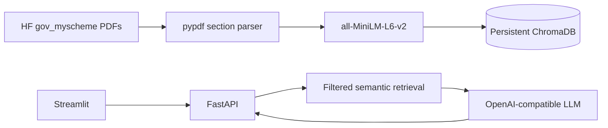

# 🇮🇳 YojanaMitra (योजना मित्र)

> **🔎 Find government schemes. 📚 Understand eligibility. ✅ Apply with confidence.**

<p align="center">
  
</p>

<p align="center">
  
</p>

YojanaMitra is a retrieval-augmented government-scheme finder for Indian citizens. It retrieves text from scheme PDFs and answers with citations rather than relying on unsupported model memory.

## 💼 Resume-ready summary

**YojanaMitra — Evidence-Grounded Government Scheme Assistant**

> Built an evidence-grounded RAG application that retrieves Indian government scheme information from PDFs and generates page-cited answers for discovery, eligibility, benefits, documents, application processes, and comparison. Implemented section-aware pypdf ingestion, local sentence-transformer embeddings, ChromaDB search, FastAPI APIs, and a Streamlit interface. Added configurable similarity-threshold refusal, Docker Compose deployment, CI tests, Prometheus/Grafana metrics, rate limiting, and security scanning.

### Interview explanation

1. **Ingest:** extract real scheme PDFs and split them by meaningful sections.
2. **Embed:** convert each section into a vector using `all-MiniLM-L6-v2`.
3. **Retrieve:** search ChromaDB with semantic similarity and state/Central filters.
4. **Generate:** send only the top retrieved passages to an OpenAI-compatible LLM.
5. **Ground:** require the model to answer only from context with `[Document Name, Page X]` citations.
6. **Refuse:** return `Insufficient official policy evidence` when retrieved evidence is below the configured similarity threshold.

The project is intentionally focused: the LLM does not act as a general chatbot, and it does not invent eligibility rules or scheme details.

## 🏗️ Architecture



## 🚀 Setup

Use Python 3.11 and a virtual environment:

```powershell
py -3.11 -m venv .venv
.\.venv\Scripts\Activate.ps1
pip install -r requirements.txt
Copy-Item .env.example .env
python scripts\download_data.py
python -m src.ingest --subset 50
uvicorn src.api:app --reload
streamlit run ui.py
```

The current sample inspection observed `Details`, `Benefits`, `Eligibility`, `Exclusions`, `Application Process`, `Documents Required`, `Frequently Asked Questions`, and `Sources And References` headings. The parser chunks each section at approximately 800 characters with overlap and preserves source document/page metadata.

## 💬 Ask a question

Start the API and UI in separate terminals:

```powershell
uvicorn src.api:app --reload
streamlit run ui.py
```

Open **http://localhost:8501** and ask questions such as:

> I am a 21-year-old student from Punjab. Which scholarships can I apply for?

## 🤖 LLM providers

Set only environment variables in `.env`: `LLM_PROVIDER`, `LLM_BASE_URL`, `LLM_MODEL`, and `LLM_API_KEY`. Groq is the default endpoint; Gemini's OpenAI-compatible endpoint and Ollama work by changing these values. No model or key is hardcoded.

## 🔌 API

`POST /api/ask` accepts `{"question":"...", "profile":{"age":21,"state":"Punjab"}}`. It returns an answer, page-level source citations, retrieved sources, query type, and latency. `GET /health` and `GET /metrics` are also available.

## 📊 Evaluation

Run `python eval/run_eval.py`. It prints and saves the measured hit rate in `eval/results.json`; no result is claimed here until it is run against the indexed Chroma database.

## 🧭 Design decisions and limitations

Section-based chunks preserve the meaning of eligibility and benefits. State filtering includes the requested state **or Central** because national schemes apply across states. A configurable Chroma distance threshold prevents weak matches from reaching the LLM; the default is `RETRIEVAL_DISTANCE_THRESHOLD=1.10`. The provider-agnostic client avoids coupling retrieval to one vendor. Known failure cases include OCR-poor PDFs, ambiguous scheme names, stale source data, and rate-limited free LLM endpoints. The assistant asks for a profile before comparison qualification and always advises official verification.

Data source: myscheme.gov.in via the shrijayan/gov_myscheme dataset.

## 🐳 Docker

```powershell
docker compose up -d
docker compose --profile monitoring up -d
```

The monitoring profile provides Prometheus at **http://localhost:9090** and Grafana at **http://localhost:3000**.
