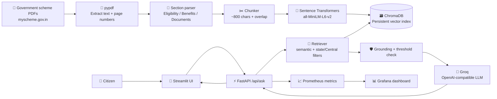

# 🇮🇳 YojanaMitra (योजना मित्र)

> **🔎 Find government schemes. 📚 Understand eligibility. ✅ Apply with confidence.**

<p align="center">
  
  
  
  
  
  
</p>

<p align="center">
  
  
</p>

YojanaMitra is an evidence-grounded RAG assistant that helps Indian citizens discover and understand government schemes from official scheme PDFs. It retrieves relevant passages, answers only from that evidence, cites document pages, and refuses weak or unsupported policy answers.

## 🎯 Problem statement

Government-scheme information is distributed across many long documents, uses inconsistent terminology, and can become outdated. Citizens need a simple way to ask profile-based, category, detail, and comparison questions without receiving invented eligibility rules or benefits.

## ✅ What the system does

- Extracts scheme PDFs from the `shrijayan/gov_myscheme` Hugging Face dataset.
- Parses observed sections such as `Benefits`, `Eligibility`, `Documents Required`, and `Application Process`.
- Creates section-aware chunks with source document and page metadata.
- Retrieves relevant Central or state-specific evidence using semantic search.
- Generates answers through Groq's OpenAI-compatible API.
- Requires `[Document Name, Page X]` citations and returns `Insufficient official policy evidence` when retrieval is below the configured threshold.

## 🏗️ System architecture



## 🧰 Technology stack and purpose

| Tool | Purpose |
|---|---|
| **Python 3.11** | Application and ingestion language |
| **pypdf** | Extracts PDF text while preserving page references |
| **Sentence Transformers** | Creates local `all-MiniLM-L6-v2` embeddings |
| **ChromaDB** | Persistent local vector database and similarity search |
| **FastAPI + Pydantic** | Typed backend API, validation, health, and metrics endpoints |
| **Groq** | Fast, low-cost LLM inference through an OpenAI-compatible API |
| **Streamlit** | Conversational web interface with profile inputs and sources |
| **Docker Compose** | Reproducible API, UI, and optional monitoring services |
| **Prometheus + Grafana** | Request, latency, retrieval, and error observability |
| **pytest + Ruff** | Offline tests and Python linting |
| **GitHub Actions + Gitleaks** | Automated CI checks and secret scanning |

## 🚀 Setup

Use Python 3.11 and a virtual environment:

```powershell
py -3.11 -m venv .venv
.\.venv\Scripts\Activate.ps1
pip install -r requirements.txt
Copy-Item .env.example .env
python scripts\download_data.py
python -m src.ingest --subset 50
```

### Environment secrets and configuration

Never commit `.env`. Copy `.env.example` to `.env` and set:

```dotenv
LLM_PROVIDER=groq
LLM_BASE_URL=https://api.groq.com/openai/v1
LLM_MODEL=your-groq-model-name
LLM_API_KEY=your-groq-api-key
```

`LLM_API_KEY` is the only secret required for Groq. The model name is deliberately configured through the environment and is not hardcoded. `LLM_RATE_DELAY`, `API_RATE_LIMIT`, `SUBSET_SIZE`, and `RETRIEVAL_DISTANCE_THRESHOLD` control local rate limiting, indexing size, and refusal behavior.

### Run locally

Start the backend and UI in separate terminals:

```powershell
uvicorn src.api:app --reload
streamlit run ui.py
```

Open **http://localhost:8501**.

### Run with Docker

```powershell
docker compose up -d
docker compose --profile monitoring up -d
```

The API is available at **http://localhost:8000**, the UI at **http://localhost:8501**, Prometheus at **http://localhost:9090**, and Grafana at **http://localhost:3000**.

## 💬 Sample questions

1. **Profile discovery:** “I am a 21-year-old student from Punjab. Which scholarships can I apply for?”
2. **Category search:** “What schemes are available for women entrepreneurs?”
3. **Detail lookup:** “What are the eligibility criteria, benefits, documents, and application process for this scheme?”
4. **Comparison:** “Compare scheme A and scheme B. Which one may I qualify for?”
5. **Evidence refusal:** “What is today's weather?” → `Insufficient official policy evidence`

## 🔌 API

`POST /api/ask` accepts:

```json
{
  "question": "Which scholarships may I qualify for?",
  "profile": {"age": 21, "state": "Punjab", "occupation": "student"}
}
```

It returns the answer, query type, latency, and retrieved sources with scheme name, section, source document, and page number. `GET /health` and `GET /metrics` are also available.

## 📊 Results and verification

- **100** prioritized scheme PDFs indexed for the fast local subset.
- **839** section-aware ChromaDB chunks generated.
- **7 tests passed** covering parsing, chunking, retrieval filters, classification, refusal mode, API validation, and health.
- Ruff checks pass.
- Page metadata and refusal behavior verified locally.
- In-domain retrieval distance observed around **0.86**; unrelated query distance observed around **1.83**, with the default refusal threshold set to **1.10**.

Run the retrieval evaluation against your local index:

```powershell
python eval\run_eval.py
```

The measured results are written to `eval/results.json`; no unexecuted evaluation score is claimed here.

## 🧭 Design decisions and limitations

Chunks are split by meaningful document sections so eligibility and benefits remain together. State filtering includes the requested state **or Central**, because nationwide schemes can apply across states. The LLM receives only the top retrieved passages and must cite their document pages. OCR-poor PDFs, ambiguous scheme names, stale source data, and free-tier rate limits can still affect results. Users should always verify current details on **myscheme.gov.in**.

Data source: `myscheme.gov.in` through the `shrijayan/gov_myscheme` dataset.
